# NOVA RP Binder

Своя админ-панель для NOVA RP (GTA V / RAGE MP): ответы, команды, наказания, панель поверх игры, журнал и статистика.

## Установка
1. Скачайте `NOVA-RP-Binder-Setup.exe` из [последнего релиза](https://github.com/Dream4ik5V/nova-rp-binder/releases/latest).
2. Запустите — установка для текущего пользователя, без прав администратора.
3. Первый запуск: можно выбрать папку установки. Дальше приложение обновляется само (тихо, при запуске).

## Быстрый старт
1. **Настройки → Окно игры**: проверьте процессы игры (`GTA5.exe, RAGE Multiplayer.exe, RAGEMP.exe`) и нажмите «Проверить окно» при запущенной игре.
2. **Ответы / Команды / Наказания**: создайте бинды (`+ Добавить`), укажите текст, хоткей (кнопка «Записать») и «Показывать на панели».
3. Включите биндер: **F6** (или кнопка на главной).
4. В игре: **F7** — панель с биндами, клик по кнопке отправляет текст в чат. **Ctrl+F6** — остановить действие.
5. Хоткей бинда можно нажать прямо в игре — текст уйдёт в чат.


## Скриншоты

**binder-about.png**

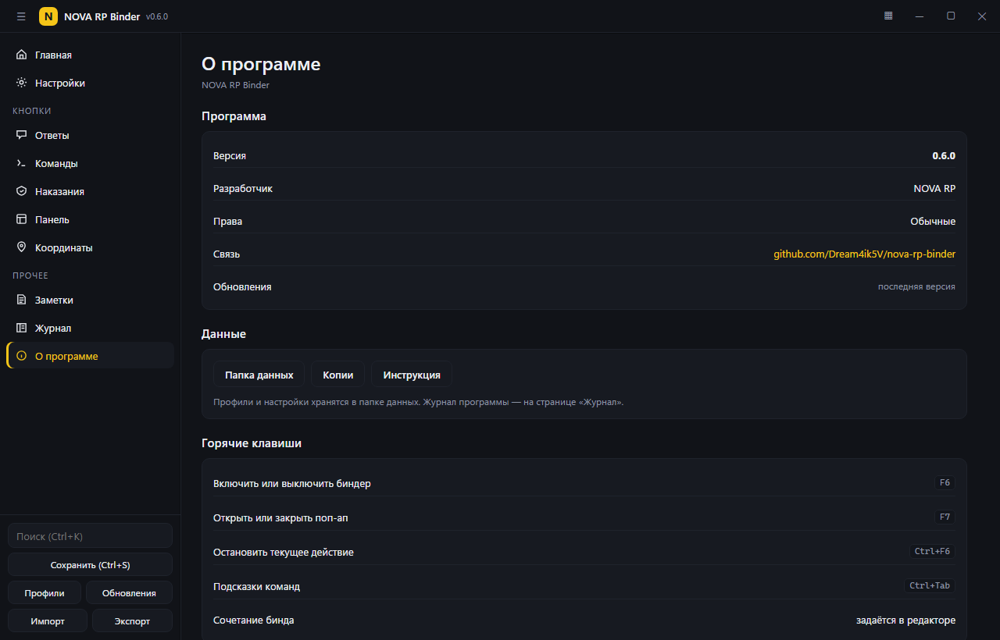

**Ответы**

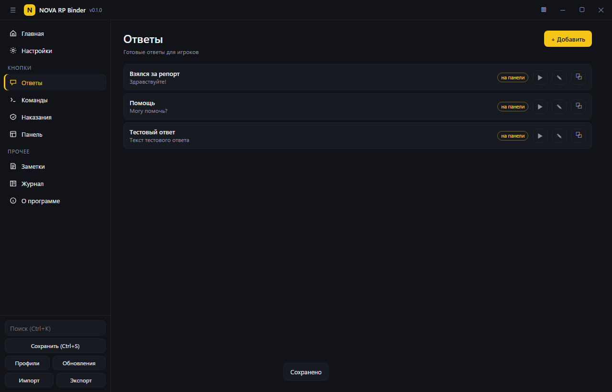

**Команды с параметрами**

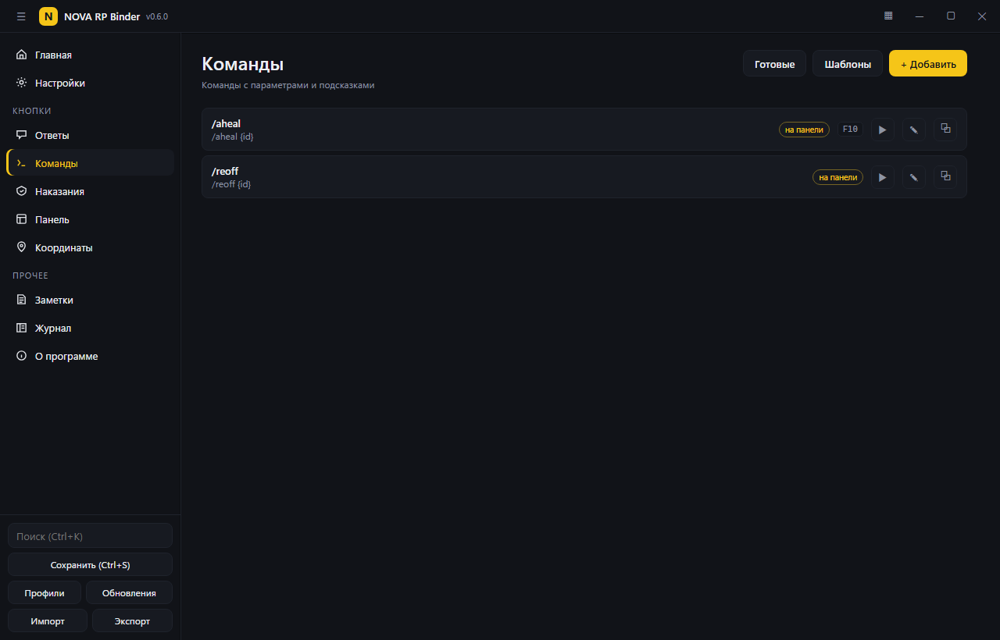

**Координаты: точки кликов в окне игры**

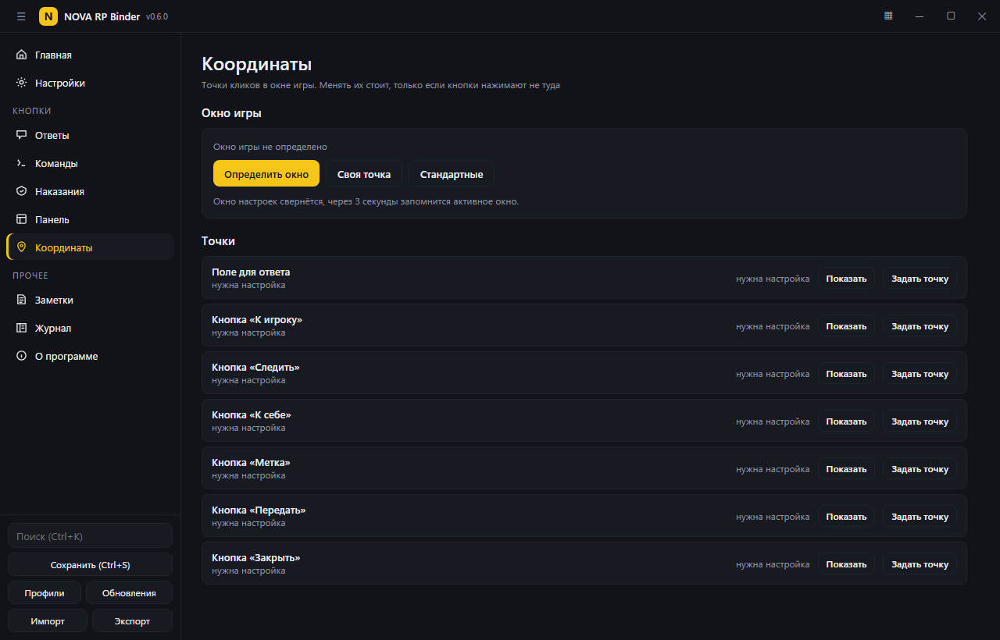

**Счётчик ответов**

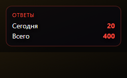

**Редактор бинда**

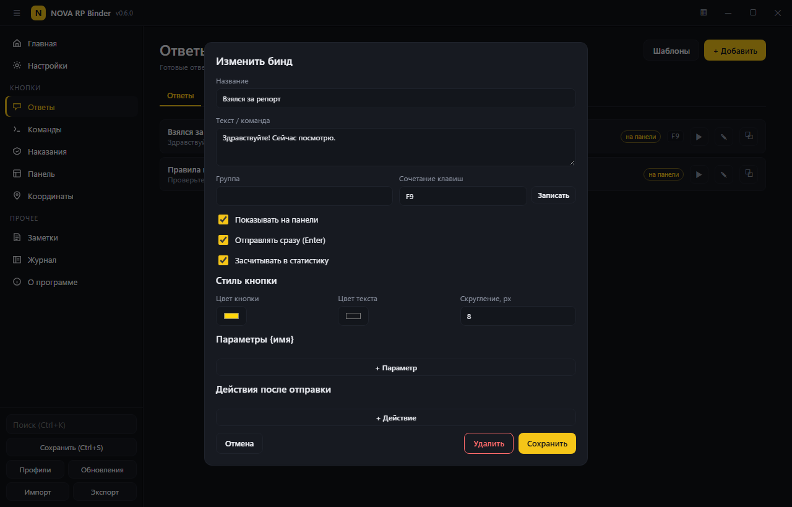

**Подсказки команд (Ctrl+Tab)**

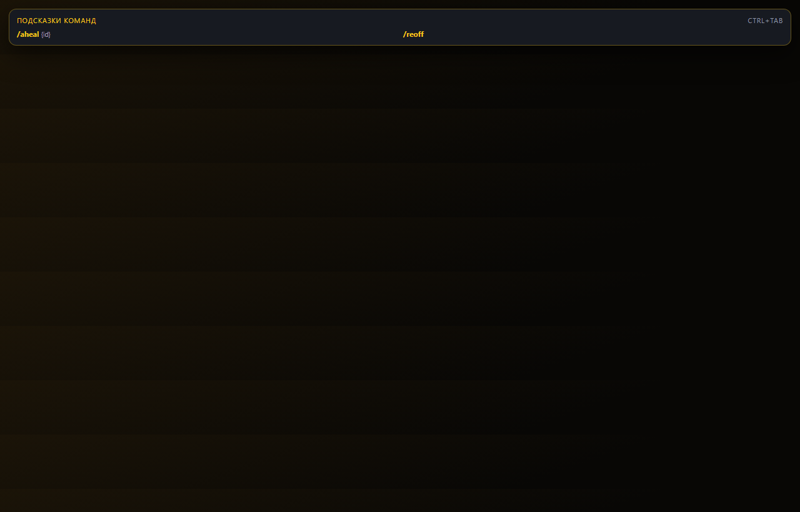

**Главная: биндер, статистика, сравнение, последние действия**

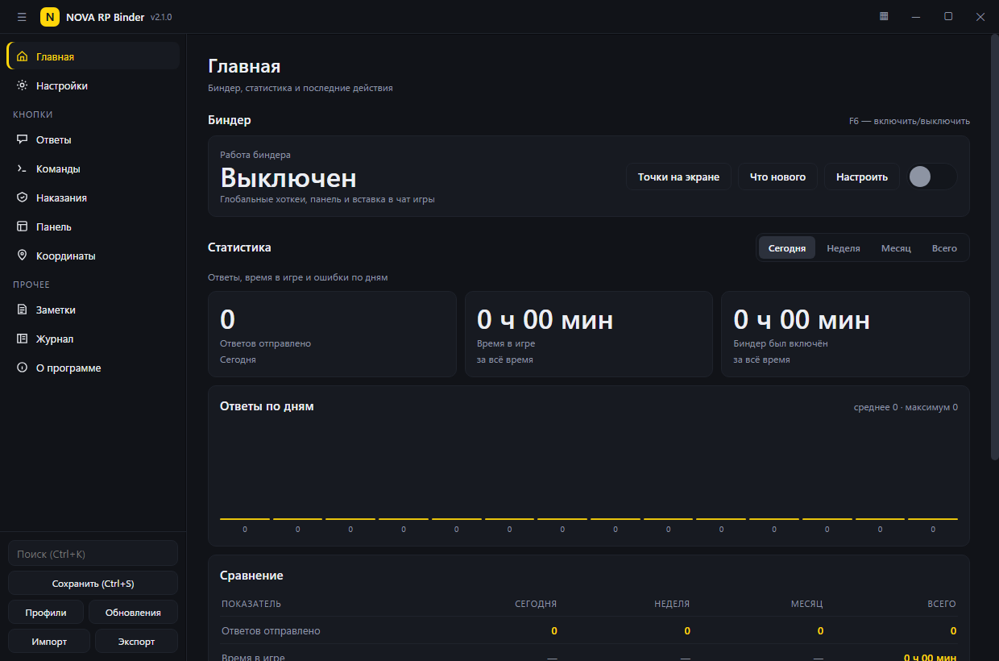

**Журнал**

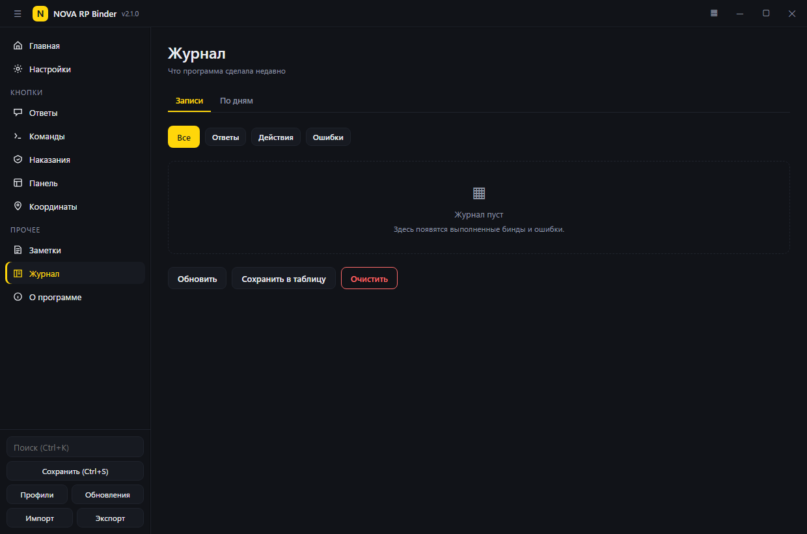

**Заметки и браузер**

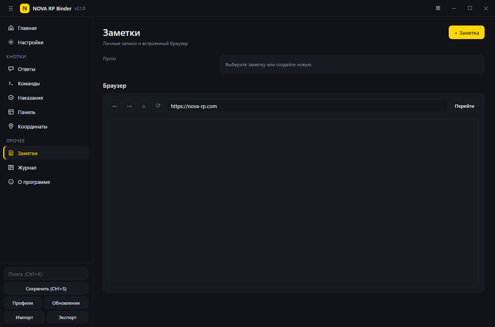

**Панель поверх игры**

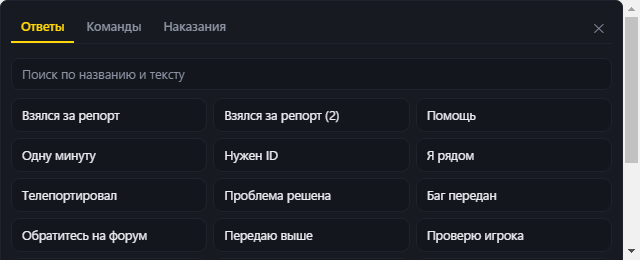

**Панель: раскладка, положение, стиль**

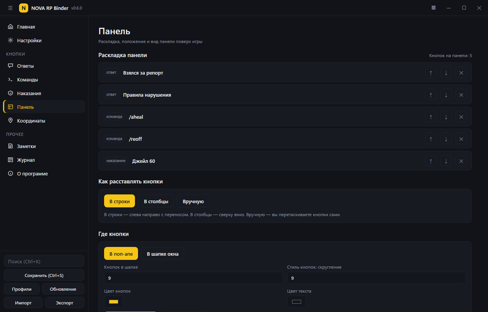

**Наказания**

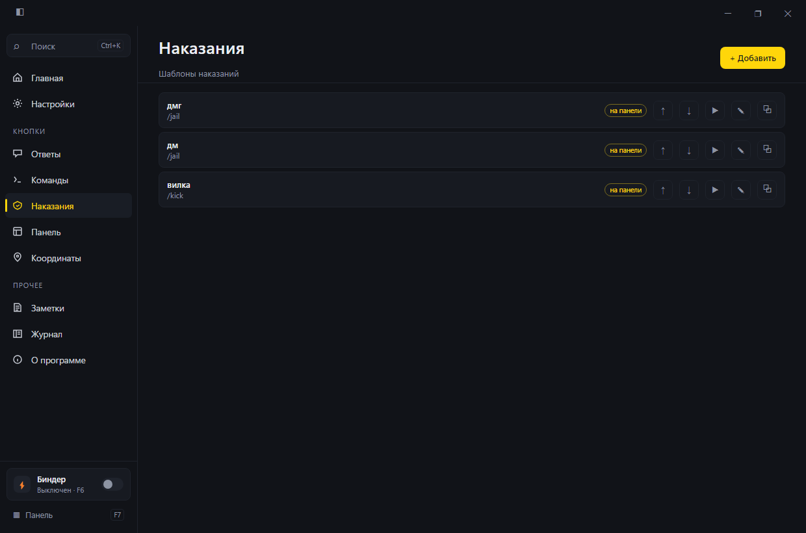

**Настройки: окно игры, ввод, задержки**

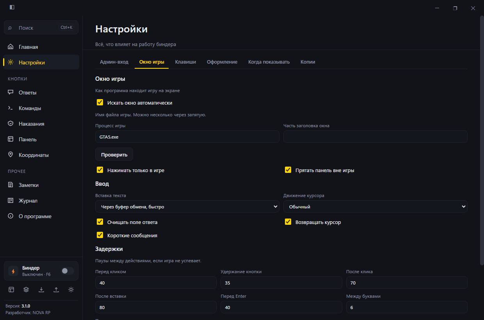

## Возможности
- Глобальные хоткеи, вставка в чат игры через буфер или «печать по буквам».
- Панель поверх игры: вкладки, поиск, шапка/поп-ап, прозрачность, масштаб, положение, стили кнопок.
- Параметры `{имя}` с окном-запросом, действия после отправки, сокращения (автозамена).
- Журнал действий с фильтрами и экспортом в CSV, статистика ответов по дням и времени.
- Заметки со встроенным браузером.
- Темы: Nova, Чёрная, Зелёная, Полночь, Закат, Светлая + свой акцент.
- Профили: экспорт/импорт файлом, «код профиля», ежедневные резервные копии (7 дней).
- Счётчик ответов поверх игры, умная панель (только когда активна игра).

## Для разработки
```
cd binder
npm install
npm start
```
Сборка установщика: `node binder/scripts/build_setup.cjs` (нужен Node.js, electron-builder в корне репозитория-студии и .NET Framework csc).

Требования: Windows 10/11 x64, установленный .NET Framework 4.8 (есть в Windows).
